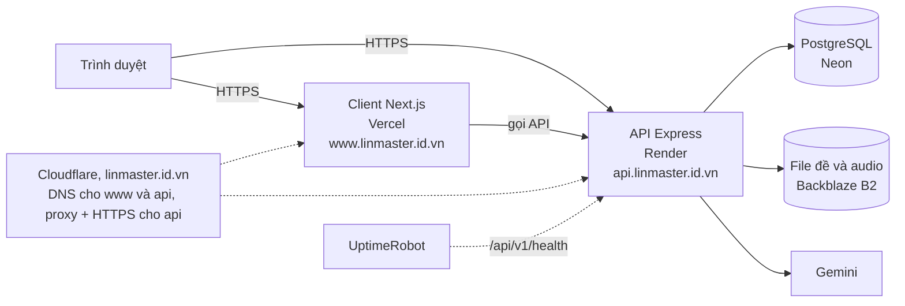

# LinMaster

> **Lin** trong *Linguistic*. Nền tảng web học ngoại ngữ dùng AI, kết hợp trích xuất từ vựng theo ngữ cảnh và phòng thi mô phỏng thi máy (CBT).

Đồ án môn **Phát triển ứng dụng Web (MSIS207)** — Trường Đại học Công nghệ Thông tin, ĐHQG-HCM.
Giảng viên hướng dẫn: ThS. Nguyễn Thanh Bình / ThS. Trần Vĩnh Khiêm.

## Tổng quan đề tài

Người học ngoại ngữ, đặc biệt là người luyện IELTS, thường gặp hai khó khăn:
- Học từ vựng theo danh sách rời rạc, không có ngữ cảnh nên nhanh quên.
- Bỡ ngỡ với giao diện thi trên máy tính.

Các nền tảng hiện có thường chỉ giải quyết một trong hai vấn đề này.

**LinMaster** nối việc luyện thi và học từ thành một vòng học khép kín:

**Đọc tài liệu → Tra từ theo ngữ cảnh → Kho từ → Flashcard → Thi thử → Mở bài đọc từ kết quả → …**, có dashboard theo dõi toàn bộ vòng học.

| Module | Chức năng |
|---|---|
| **Trình đọc & kho từ** | Dán văn bản hoặc tải PDF/DOCX/TXT để đọc. Bôi chọn từ → AI giải thích theo đúng câu đó (nghĩa Anh–Việt, IPA, cách dùng, collocations) → lưu vào kho từ kèm câu gốc. Lọc nhanh từ theo CEFR / chủ đề |
| **Flashcard** | Tạo và sửa bộ thẻ kiểu Quizlet, tạo bộ thẻ từ kho từ. Học bằng thẻ lật và lặp lại ngắt quãng SM-2 |
| **Phòng thi CBT** | Tải đề lên theo hai cách: **Theo mẫu** (mỗi ô một file) hoặc **AI nhận diện** (thả file tùy ý, AI tự tìm đề, câu hỏi, đáp án, giải thích, transcript và báo phần còn thiếu). Làm bài trên giao diện bám sát thi máy IELTS, chấm điểm, quy ra band |
| **Kho cộng đồng** | Đăng bộ thẻ và đề lên kho chung, tìm kiếm, xem trước, chép bộ thẻ, làm đề, báo cáo vi phạm |
| **Dashboard** | Trang cá nhân kiểu hồ sơ GitHub: lịch hoạt động, chuỗi ngày học, số liệu, điểm yếu theo dạng câu |

Giao diện song ngữ Việt / Anh. Chi tiết phạm vi xem [docs/PLAN.md](docs/PLAN.md) Phần A.

## Bản chạy thật (production)

| | Địa chỉ |
|---|---|
| Web | https://www.linmaster.id.vn |
| Tài liệu API (Swagger) | https://api.linmaster.id.vn/docs |
| Kiểm tra API còn sống | https://api.linmaster.id.vn/api/v1/health → `{"status":"ok"}` |

Tài khoản demo (dữ liệu mẫu công khai, có sẵn tài liệu, bộ thẻ và đề mẫu): email `demo@linmaster.app`, mật khẩu xem trong [server/prisma/seed.ts](server/prisma/seed.ts).



## Tài liệu dự án

| Tài liệu | Nội dung |
|---|---|
| [docs/Working_rules.md](docs/Working_rules.md) | Luật và quy trình làm việc cho thành viên và AI Agent: Git, PR, review, quy chuẩn code, API, bảo mật, deploy, checklist |
| [docs/Project_Structure.md](docs/Project_Structure.md) | Tech stack, kiến trúc, cấu trúc thư mục và giải thích chi tiết |
| [docs/PLAN.md](docs/PLAN.md) | Kế hoạch, phạm vi, lộ trình và backlog |
| [docs/Database.md](docs/Database.md) | Cơ sở dữ liệu: bảng, ràng buộc, migration |
| [Analysis_Design/](Analysis_Design/README.md) | Sơ đồ phân tích và thiết kế: ERD, use case, activity, sequence, state, kiến trúc |

## Chạy ở máy

Cần Node 22 (xem `.nvmrc`) và Docker Desktop.

```bash
npm install
docker compose up -d                 # PostgreSQL 16: linmaster_dev và linmaster_test ở cổng 5432
cp server/.env.example server/.env   # điền JWT_SECRET (≥ 32 ký tự, cách tạo ghi trong file); GEMINI_API_KEY nếu muốn dùng AI
npm run db:migrate -w server         # áp các migration của Prisma vào linmaster_dev
npm run db:seed -w server            # nạp dữ liệu mẫu (chạy lại nhiều lần vẫn an toàn)
npm run dev                          # client http://localhost:3000 · API http://localhost:4000/api/v1
```

Cổng 5432 đã bị chiếm thì đặt `POSTGRES_PORT=5433` trước `docker compose up` và sửa cổng trong `server/.env`. Xóa sạch dữ liệu local: `docker compose down -v`.

## Luật merge vào `main`

Repo là **public** và chưa bật branch protection trên GitHub. Các luật dưới đây vẫn **bắt buộc** và được cả nhóm **tuân thủ thủ công** (chi tiết ở [Working_rules mục 5.5](docs/Working_rules.md)):

- Không push thẳng vào `main`, không force push, không xóa `main`. Mọi thay đổi đi qua Pull Request từ branch `<loại>/<số-issue>-<mô-tả>` (giai đoạn đầu dùng mã việc của PLAN, ví dụ `feat/p1-06-auth-server`).
- Mỗi PR cần được **duyệt** (người còn lại hoặc QA kết luận Đạt; KH được tự duyệt PR của mình) và CI xanh. Người mở PR bấm merge sau khi đủ hai điều kiện.
- Chỉ dùng **Squash and merge**. Merge xong thì xóa branch.
